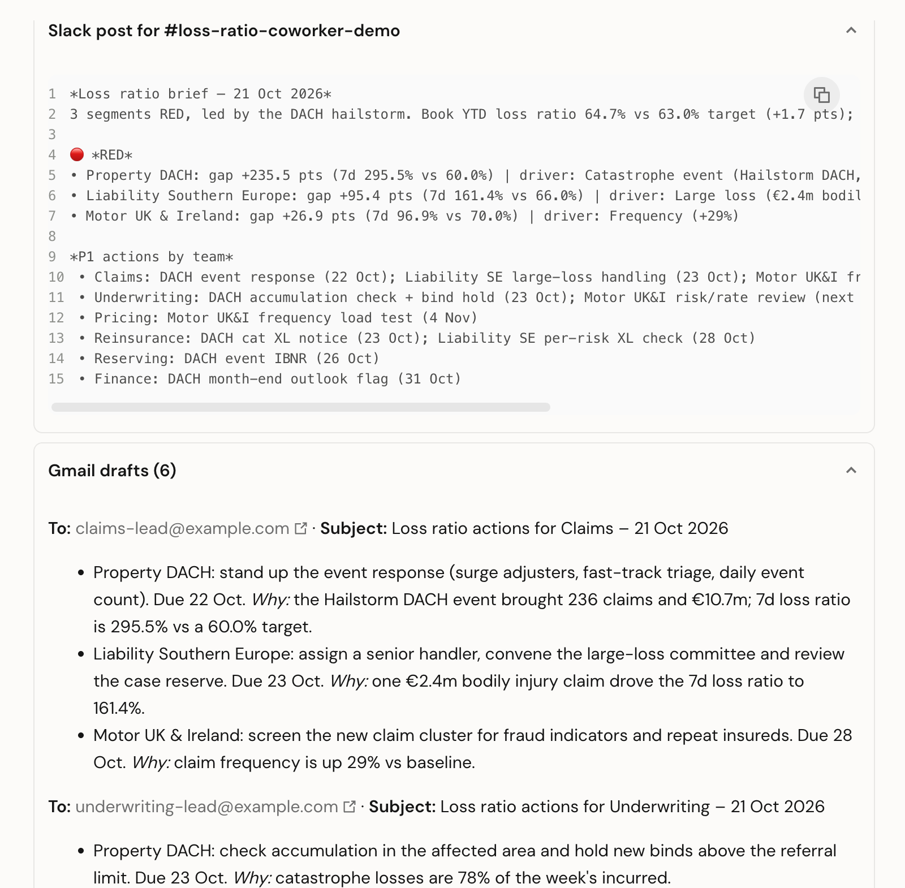
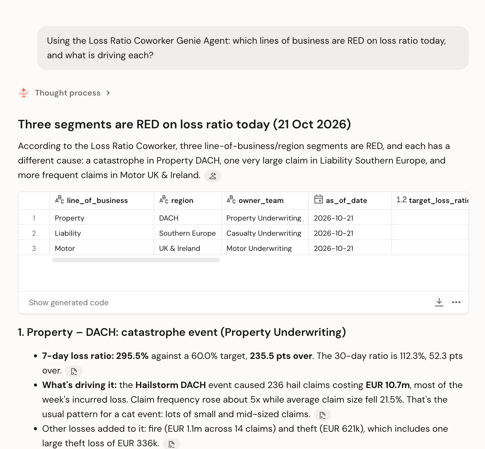

# Genie Loss Ratio Coworker

**Manage the insurance loss ratio daily, not monthly, with Databricks Genie One, Genie Agents, Genie Ontology,
an AI/BI dashboard, and Genie One's Slack and Gmail connectors.**

Every weekday morning the coworker finds the segments whose loss ratio moved, explains *why* (frequency, severity,
catastrophe, large loss), recommends owned actions for Claims, Underwriting, Pricing, Reinsurance, Reserving and Finance,
posts the brief to **Slack**, and leaves each team's actions as a **Gmail draft** ready for the executive to send. All data is synthetic.


---

## For executives: what changes

| Moment | Today | With the coworker |
|---|---|---|
| 07:30 | Nothing on loss ratio until the month-end pack | Genie One posts the brief in Slack: what's RED, why, who's acting |
| Exec meeting | "Why is Property up?" becomes an analyst ticket | `@Genie why did DACH Property jump?` is answered in the meeting, with the SQL |
| Reinsurance | Hears about the event at month-end | Has a P1 action with a 48-hour due date the same morning |
| Follow-up | Writes six emails to team leads | Opens Gmail: six drafts, one per team, with actions, due dates and the why. Review, send |
| Board pack | Debates whose loss ratio is right | One governed number, next to the AM Best and AXA benchmarks |

Context: the US P&C industry combined ratio was **92.9% in FY2025** (AM Best, 96.6% in FY2024); AXA reported a
**90.6%** P&C combined ratio for FY2025 (94.1% undiscounted). In a market this tight, a few points of loss ratio decide
the year, and they move between month-ends.

| Morning brief (Genie One skill) | Recommended actions (dashboard) |
|---|---|
|  |  |

| Genie One writes the Slack post + Gmail drafts | Genie One explains the RED segments |
|---|---|
|  |  |

More: [dashboard](docs/screenshots/01_dashboard.png) · [skill in Genie One](docs/screenshots/05_skill_invoke.png) ·
[actions by team](docs/screenshots/07_brief_actions_by_team.png) · [scheduled task](docs/screenshots/08_scheduled_task.png) ·
[Gmail drafts](docs/screenshots/11_genie_one_gmail_drafts.png)

---

## For builders: what's in the repo

| Path | What it is |
|---|---|
| `src/setup/01_generate_loss_run.py` | Synthetic European commercial P&C book (150k policies, ~77k claims, daily earned premium) with three seeded events: a DACH hailstorm, a UK motor frequency creep and a EUR 2.4m bodily-injury loss |
| `src/setup/02_semantic_layer.py` | Gold daily loss run, targets/thresholds/owners, public benchmarks, **metric views** `mv_loss_ratio` and `mv_loss_run` (YAML 1.1 with display names, synonyms and formats), the RAG watchlist, alert tables, comments and tags for **Genie Ontology** |
| `src/jobs/daily_loss_ratio_watch.py` | Daily job: detect RED/AMBER → ask the Genie Agent *why* → action playbook per team → Delta audit trail → Slack Block Kit and Teams Adaptive Card |
| `deploy/genie_agent.py` | Creates the **Loss Ratio Coworker** Genie Agent (tables, instructions, example SQL, sample questions) |
| `deploy/dashboard.py` | Creates and publishes the **Daily Loss Ratio Watch** AI/BI dashboard |
| `skills/loss-ratio-daily-brief.md` | The **Genie One skill**: brief → Slack post → one Gmail draft per team, and how to schedule it |
| `docs/APPROACH.md` | Detailed design: problem, principles, detection logic, playbook, governance, 6-week rollout, risks |
| `docs/CONNECT_SLACK_TEAMS_GMAIL_OUTLOOK.md` | Step-by-step setup for Slack, Microsoft Teams, Gmail and Outlook: Genie One connectors, the Genie apps, the webhook job, a checklist and troubleshooting |
| `docs/article/linkedin_article.md` | The accompanying article |

### Quick start

Prerequisites: a Unity Catalog workspace with serverless compute and a serverless SQL warehouse, Genie One enabled,
the Databricks CLI.

```bash
export DATABRICKS_CONFIG_PROFILE=<profile>
export LRC_CATALOG=<catalog> LRC_WAREHOUSE_ID=<warehouse-id>

# 1. Deploy the jobs, then build the data and semantic layer
databricks bundle deploy --var catalog=$LRC_CATALOG --var warehouse_id=$LRC_WAREHOUSE_ID
databricks bundle run lrc_setup --var catalog=$LRC_CATALOG --var warehouse_id=$LRC_WAREHOUSE_ID

# 2. Genie Agent and dashboard
python deploy/genie_agent.py        # prints GENIE_SPACE_ID=...
python deploy/dashboard.py

# 3. Redeploy with the agent id and run the daily watch (dry run)
databricks bundle deploy --var catalog=$LRC_CATALOG --var warehouse_id=$LRC_WAREHOUSE_ID --var genie_space_id=<id>
databricks bundle run lrc_daily_watch --var catalog=$LRC_CATALOG --var warehouse_id=$LRC_WAREHOUSE_ID --var genie_space_id=<id>
```

Then in Genie One: connect **Slack** and **Gmail** or **Microsoft 365** (for Outlook), create the skill from
`skills/loss-ratio-daily-brief.md`, run `/loss-ratio-daily-brief`, and ask *"Schedule this every weekday at 07:30"*.
For Slack, Microsoft Teams, Gmail and Outlook setup (connectors, the Genie apps, webhooks, write-tool enablement and
troubleshooting) follow [`docs/CONNECT_SLACK_TEAMS_GMAIL_OUTLOOK.md`](docs/CONNECT_SLACK_TEAMS_GMAIL_OUTLOOK.md).

### Design notes

- **One definition.** Loss ratio = incurred ÷ earned, defined once in a metric view; every surface reads it.
- **Deterministic detection.** Thresholds (per line, in `lr_targets`) and the playbook are rules; Genie explains, it doesn't decide.
- **Context matters.** Genie One searches every Genie asset you can see. Name the agent in the skill, or pin it to a
  Slack/Teams channel, so loss-ratio questions stay on the governed agent.
- **Human on the send button.** The Gmail connector drafts but cannot send; the executive reviews every instruction.
- **Governance.** Genie One, its connectors and Genie Agents run with the user's Unity Catalog permissions through Unity
  Gateway. Connector write tools start read-only and are enabled per workspace by an admin.
- **Status.** The Genie apps for Slack and Teams are Public Preview and skill sharing is Beta at the time of writing.

### Sources

- AM Best, *US Property/Casualty 2025 Financial Results*: <https://www.ambest.com/bestlink/IndustryReports/pcssaft1new.pdf>
- AXA, *Full-Year 2025 Earnings*: <https://www.axa.com/press/press-releases/2025-full-year-earnings>
- Databricks docs: [Genie One in Slack](https://docs.databricks.com/aws/en/genie-one/genie-slack) ·
  [Genie in Microsoft Teams](https://docs.databricks.com/aws/en/integrations/msft-teams) ·
  [Genie One connectors](https://docs.databricks.com/aws/en/genie-one/external-sources) ·
  [Genie Ontology](https://docs.databricks.com/aws/en/genie/genie-ontology) ·
  [Metric views](https://docs.databricks.com/aws/en/uc-semantics/metric-views/)

*Synthetic data only. AXA and AM Best figures are public and used as market context, not as targets. Not an official
Databricks product.*
