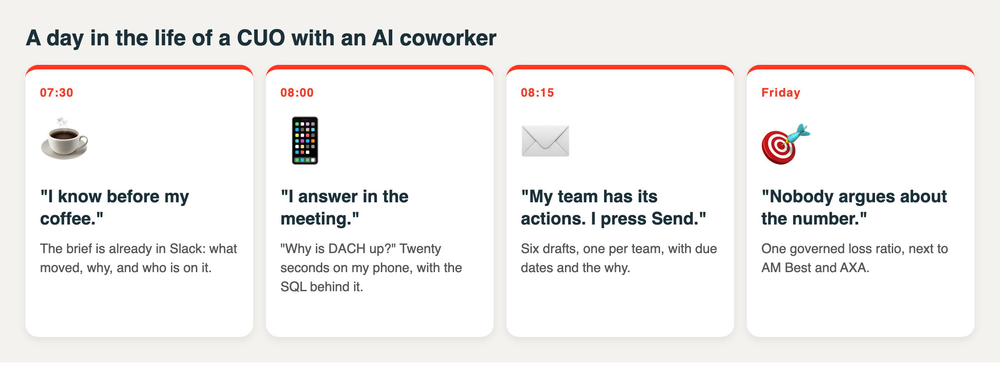
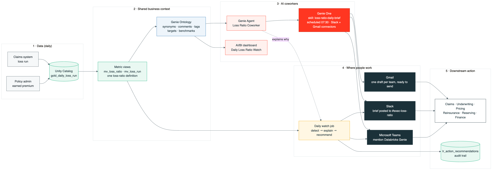
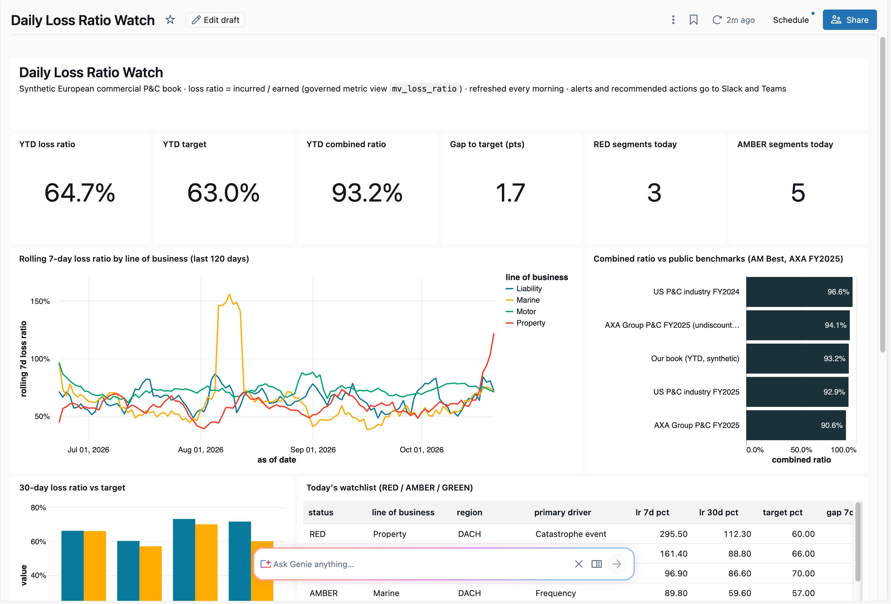
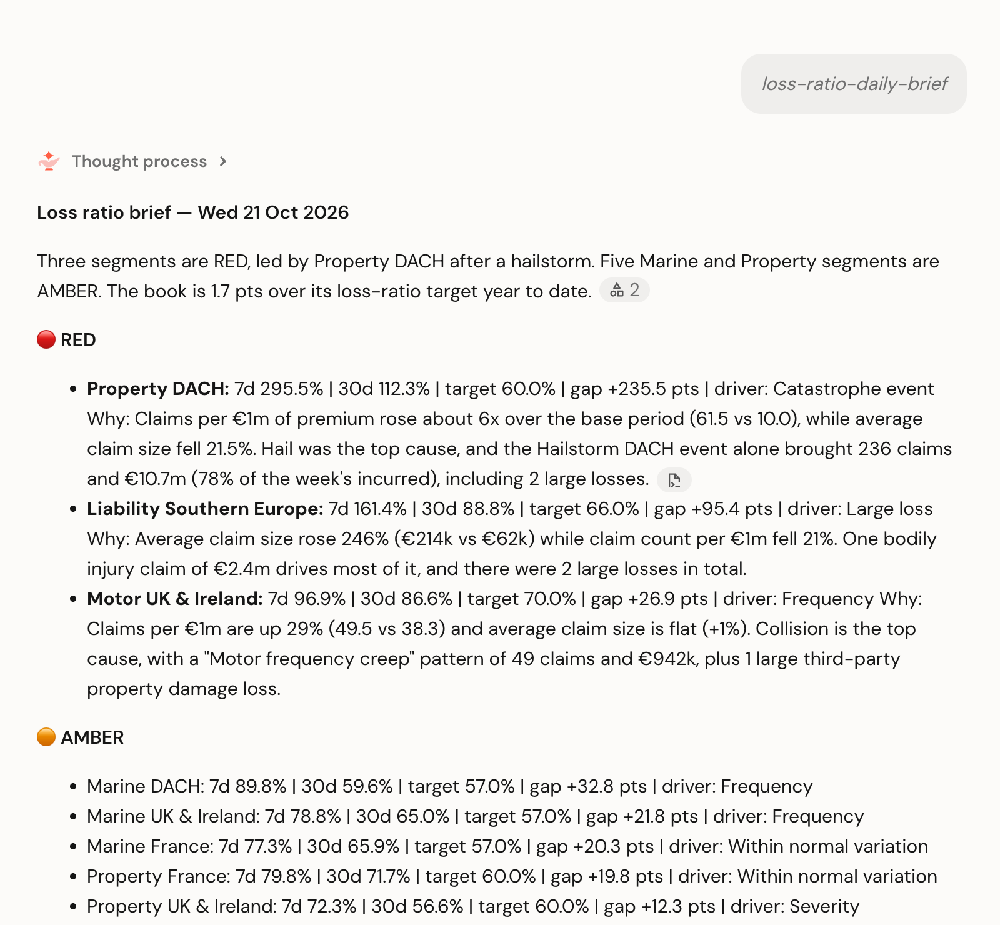
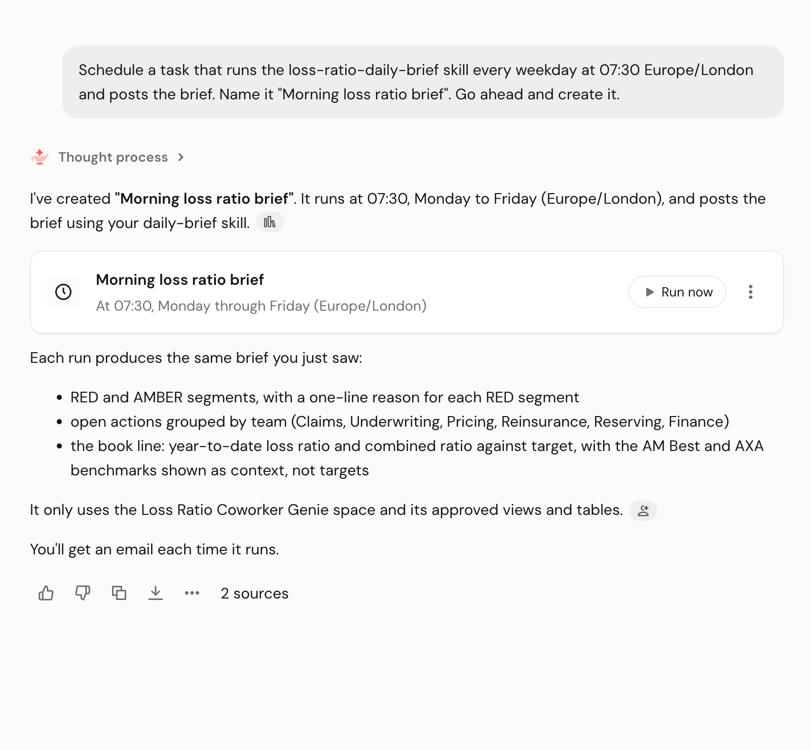
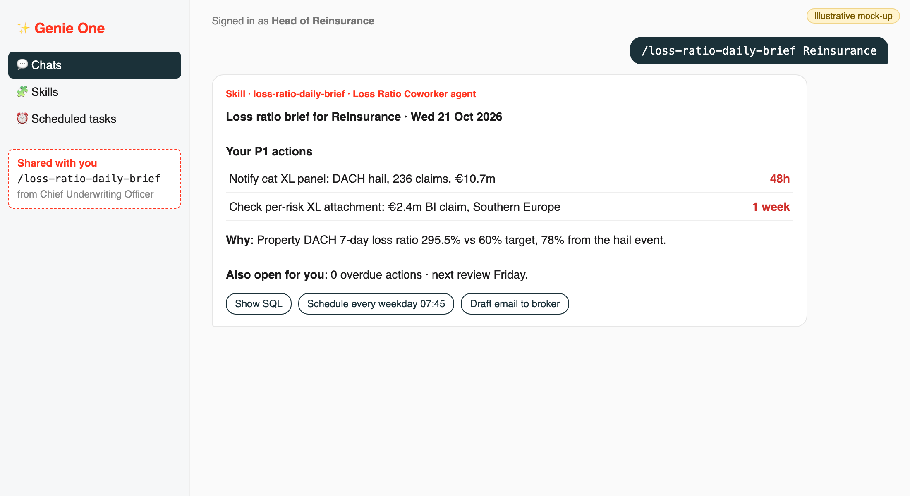
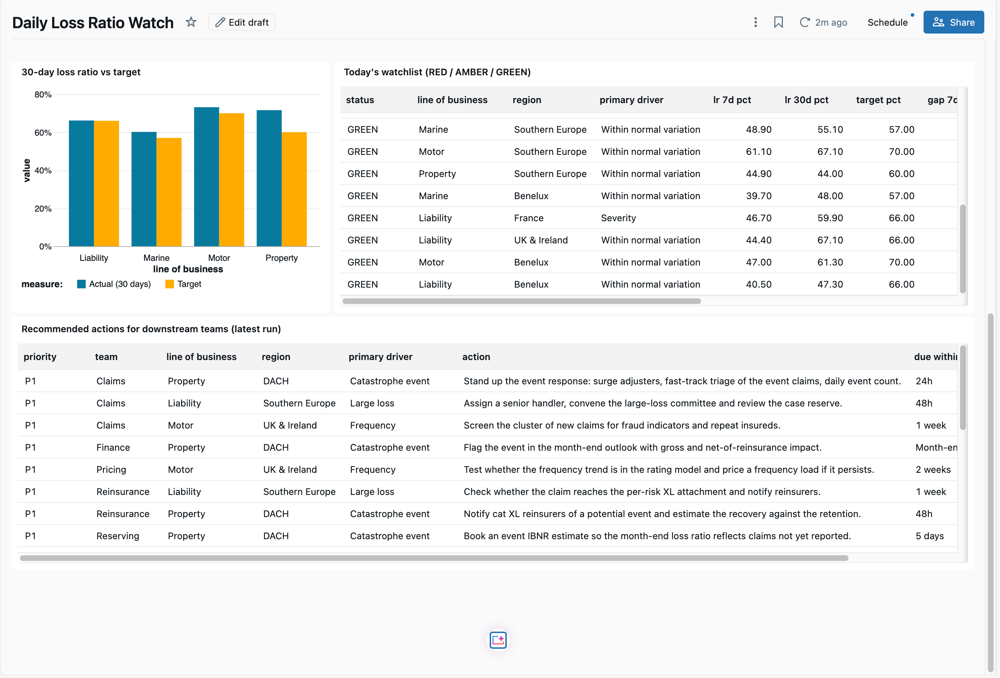
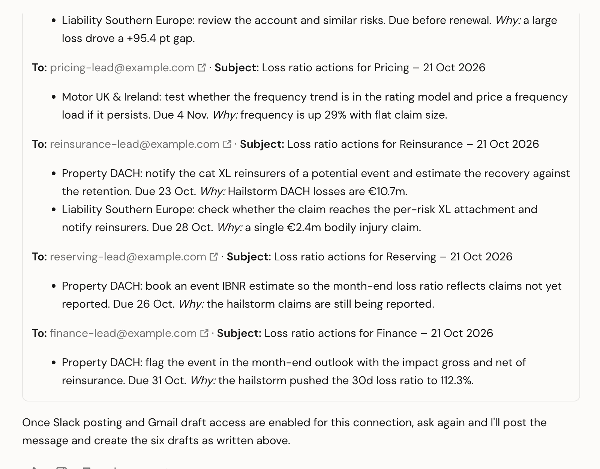
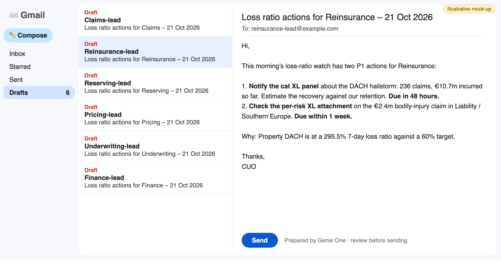
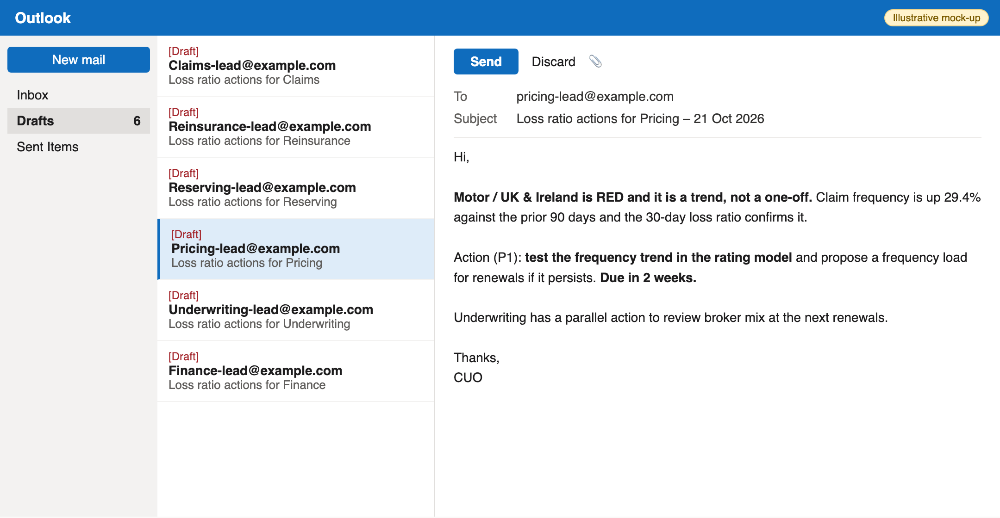

# The Hailstorm Hit on Thursday. My AI Coworker Told Me Before Friday's Coffee.

*How an insurer can manage its loss ratio every day with Genie One*

**SEO title:** How to manage the insurance loss ratio daily with Genie One, Slack and Gmail
**SEO description:** A practical blueprint: governed metric views, Genie Ontology, a Genie Agent, a Genie One skill that posts to Slack and prepares Gmail drafts, turning the loss run into a daily decision for insurance executives.

---

**Summary: from month-end surprise to a 7:30 a.m. decision**

- ⏱️ **From weeks to the same morning.** A loss-ratio problem gets an owner and a due date before the first meeting, not three weeks later in the month-end pack.
- ☕ **Your loss ratio, briefed before your first coffee.** Genie One posts what's RED, why, and who is acting in Slack at 07:30.
- 📱 **Ask "why?" from your phone and get the answer, with the SQL, in the meeting.** No analyst ticket.
- ✉️ **Six follow-up emails, three taps.** Each team's actions wait in your Drafts folder, ready to review and send.
- 🎯 **One number, everywhere.** A single governed loss-ratio definition behind the dashboard, the agent, Slack, Teams and email.
- 🔓 **Want to try it out? Check out this repo.** Open source, built on synthetic data: **[github.com/saswata30/genie-loss-ratio-coworker](https://github.com/saswata30/genie-loss-ratio-coworker)**

*From 14 tabs and six versions of "the" loss ratio to one question and one governed number.*

---

## Why does the loss ratio need daily attention?

The **loss ratio** is incurred losses divided by earned premium. It is the single number that tells an insurer whether it is pricing risk correctly. Most carriers still see it in a month-end pack, three to six weeks after the losses were reported.

The market makes those weeks expensive. The US property and casualty industry ran a **92.9% combined ratio in 2025**, down from 96.6% in 2024 ([AM Best](https://www.ambest.com/bestlink/IndustryReports/pcssaft1new.pdf)). AXA reported a **90.6% P&C combined ratio for full-year 2025**, or 94.1% before the discounting benefit ([AXA FY2025 results](https://www.axa.com/press/press-releases/2025-full-year-earnings)). When the industry sits in the low 90s, a few points of loss ratio separate a strong year from an average one, and they are lost between month-ends: in the hailstorm nobody told Reinsurance about, or the motor frequency trend renewed into next year's book.

Working with European insurers, I've found the data is rarely the hard part. The hard part is that "loss ratio" means something slightly different in every deck, and the people who must act (Claims, Reinsurance, Underwriting) hear about it last.

## What is an AI coworker for insurance executives?

**Genie One** is Databricks' AI coworker for business users. It answers questions in plain language over governed enterprise data, runs reusable **skills**, runs **scheduled tasks**, and works inside Slack and Microsoft Teams. **Genie Agents** (formerly Genie spaces) are domain-specific agents that Genie One calls for a subject such as the loss ratio. **Genie Ontology** is the context layer that combines curated Unity Catalog semantics (metric views, comments, synonyms, tags) with context Genie infers from usage.

*The executive's day, told in four sentences.*

## How does the daily loss-ratio coworker work?

*The flow: claims and premium land daily in Unity Catalog, metric views define the loss ratio once, Genie Ontology adds business context, and Genie One delivers the brief and the actions where people work.*

| Layer | What it does | Built with |
|---|---|---|
| Daily loss run | Claims by report date and earned premium per day, by line of business and region | Delta tables in Unity Catalog |
| One definition | Loss ratio, combined ratio, frequency, severity, target gap | Unity Catalog **metric views** (with display names, synonyms and formats) |
| Business context | Targets, alert thresholds, owner teams, public benchmarks, comments and synonyms | Unity Catalog + **Genie Ontology** |
| Daily watch | 7-day, 30-day and year-to-date loss ratio, frequency vs severity, RED/AMBER/GREEN | A SQL view and a scheduled job |
| Coworker | Answers "why?", writes the morning brief | **Genie Agent** + **Genie One skill** |
| Delivery | Brief in Slack, actions as ready-to-send emails | **Genie One connectors** for **Slack** and **Gmail** |

Two design choices matter most. **Detection is deterministic**: thresholds and the action playbook live in tables and code, so every alert can be explained to an auditor; Genie explains *why* a segment moved, not *whether* it is red. And there is **one definition everywhere**: the dashboard, the agent, Genie One and the alert job all read the same metric view.

## What does the executive actually see at 7:30?

*How the executive's morning changes. Signal to owned action goes from weeks to the same morning.*

*Year-to-date loss ratio 64.7% against a 63.0% plan, and a 93.2% combined ratio next to the 92.9% US industry figure.*

Before that meeting, the Genie One skill `/loss-ratio-daily-brief` has already run as a scheduled task at 07:30 and posted the brief:

*The morning brief written by the skill: RED and AMBER segments, each with the gap to target and the reason, followed by actions by team and the book line.*

*One sentence in Genie One turned the skill into a weekday routine that posts the brief and emails it.*

Follow-up questions work the same way. When I asked Genie One *"Which lines of business are RED on loss ratio today, and what is driving each?"*, it answered:

*Genie One routes the question to the Loss Ratio Coworker agent and explains each RED segment: a catastrophe event, a single large loss and a frequency trend.*

Genie One also separated the **one-off shocks** (the hail event and the large claim) from the **persistent problem** (motor frequency, visible in the 30-day ratio) that needs pricing action.

The same questions work from a phone between meetings:

*Illustrative mock-up of Genie One on mobile, using the figures from the demo.*

## How does an executive share the skill with the whole team?

A **Genie One skill** is a reusable set of instructions that you create by chatting with Genie One and run as a slash command. The CUO doesn't write code. They describe the briefing they want once ("use the Loss Ratio Coworker agent, list RED then AMBER segments, explain why, group actions by team, post to Slack, draft one email per team") and Genie One saves it as `/loss-ratio-daily-brief`.

The real leverage comes from **sharing** it (skill sharing is in Beta at the time of writing):

1. **Create once.** The executive builds and refines the skill in a normal Genie One chat.
2. **Share with the teams that act.** Claims, Reinsurance, Underwriting, Pricing, Reserving and Finance get the same skill, so everyone reads the morning the same way.
3. **Each team runs its own view.** `/loss-ratio-daily-brief Reinsurance` returns only Reinsurance's actions, and each person can schedule it for their own start of day.
4. **Governance stays per person.** The skill runs with each user's Unity Catalog permissions, so sharing the skill never shares data someone isn't allowed to see.

*The executive shares one skill with the six teams that act on the loss ratio.*

*The Head of Reinsurance runs the same skill and sees only their own actions.*

This is what turns one executive's habit into a team operating rhythm: **the CUO's questions become everyone's morning routine.**

## How does the coworker turn a signal into action for downstream teams?

Every RED segment maps to a playbook by driver. The daily job writes the actions to a Delta table with an owner team, a priority and a due date, so Genie One can read them and anyone can ask "what is still open for Reinsurance?".

| Driver | Team | Recommended action | Due |
|---|---|---|---|
| Catastrophe event | Claims | Stand up the event response and fast-track triage | 24h |
| Catastrophe event | Reinsurance | Notify cat XL reinsurers and estimate the recovery | 48h |
| Catastrophe event | Reserving | Book event IBNR for month-end | 5 days |
| Large loss | Claims | Senior handler, large-loss committee, reserve review | 48h |
| Frequency | Pricing | Test the trend in the rating model; add a frequency load if it persists | 2 weeks |

*Recommended actions from the latest run, with priority, owner team and due date.*

## How does Genie One put the brief in Slack and the actions in Gmail?

Genie One has built-in **connectors** to the tools executives already live in. Each user signs in once, and every call goes through Unity Gateway with that user's permissions. Two of them close the loop:

| Connector | What Genie One can do | Why it matters here |
|---|---|---|
| **Slack** | Search and read messages, and **send messages** | The 07:30 brief is posted to `#exec-loss-ratio`, where the CUO reads it on a phone |
| **Gmail** | Search, read and **draft** email (it cannot send) | Each team lead's actions are waiting in the executive's Drafts folder, ready to review and send |
| **Microsoft 365** | Search SharePoint, Teams, Outlook and Calendar, and **draft Outlook email** (it cannot send) | The same drafts for Outlook shops, plus "did Reinsurance reply?" searches across Teams and Outlook |

The skill gets two extra steps: *post the executive summary to Slack*, then *create one Gmail draft per team with that team's actions, due dates and the one-line why*. This is what Genie One produced from today's data:

*Genie One writes the Slack post and one email per team from the governed views. Addresses are placeholders.*

*The Reinsurance draft already says what to do (notify cat XL reinsurers about the €10.7m hailstorm, check the per-risk XL on the €2.4m claim) and by when.*

**The executive's morning becomes three taps:** read the brief in Slack, ask `@Genie` a follow-up if needed, open Gmail and send the six drafts. Genie One never sends email on its own, which keeps a human accountable for every instruction that leaves the CUO's office.

### What it looks like where executives and teams work

The screens below are **illustrative mock-ups** of the end-to-end flow, using the demo's figures.

*Slack: the brief arrives at 07:30, the CUO asks a follow-up in the thread, and Reinsurance confirms the action before 08:05.*

*Teams: the daily watch job posts each team's alert card, and people ask Databricks Genie follow-up questions in the channel.*

*Gmail: Genie One prepares one draft per team. The executive reviews it and presses Send.*

*Outlook: the same pattern for Microsoft 365 shops, through Genie One's Microsoft 365 connector, which drafts Outlook email but cannot send it.*

Separately, the **Databricks Genie app for Slack** (Public Preview) lets people ask `@Genie` in any channel ([docs](https://docs.databricks.com/aws/en/genie-one/genie-slack)). Connector capabilities are listed in the [connector docs](https://docs.databricks.com/aws/en/genie-one/external-sources).

## What did I learn building it?

1. **Context beats prompts.** My demo workspace also contains an older insurance demo. Genie One first answered from the wrong tables. Naming the agent, or pinning it to the channel, fixed it. Clear names, comments and synonyms in Unity Catalog are what make the right agent findable.
2. **Small segments are noisy.** A 7-day loss ratio on a thin segment jumps on a single claim. Exposure weighting, per-line thresholds and a 30-day confirmation cut false alarms from eight segments to the three that mattered.
3. **Write access is a governance decision.** Genie One's Slack and Gmail connectors are governed by Unity Gateway; in my workspace they started read-only until an admin enabled the posting and drafting tools. That is the right default.

## Key takeaways

- Put the loss ratio in **one governed metric view**, and let every tool read it.
- Give the agent **business context** (targets, thresholds, owners, benchmarks, synonyms) before you give it users.
- Keep **detection deterministic** and use Genie for the explanation and the conversation.
- Deliver the brief **where executives already work** (Slack), and hand them the follow-ups **ready to send** (Gmail drafts), keeping a human on the send button.
- Measure success as **time from loss reported to owned action**, not dashboard views.

## FAQ

**What is the difference between a loss run and a loss ratio?**
A loss run is the claim-by-claim history (dates, cause, paid, reserves, incurred). The loss ratio is the summary: incurred losses divided by earned premium. The coworker uses the loss run to explain *why* the loss ratio moved.

**Can Genie One post a loss-ratio brief to Slack automatically?**
Yes. Connect Slack in Genie One, add "post the brief to #exec-loss-ratio" to the skill, and run the skill as a scheduled task each morning. The Slack connector can send messages once its write tools are enabled; scheduled tasks also email the result.

**Can Genie One send emails for me?**
No, by design. The Gmail and Microsoft 365 (Outlook) connectors can search, read and **draft** email, but they cannot send. Genie One prepares each team's email; the executive reviews it and presses send.

**Is it safe to let an AI agent answer questions on regulated insurance data?**
Genie One and Genie Agents run with each user's Unity Catalog permissions, show the SQL behind every answer, and read governed metric views rather than raw tables. Alerts and actions are written to an audit table.

*All data in this article is synthetic. AXA and AM Best figures are from their public reports and are used only as market benchmarks.*
